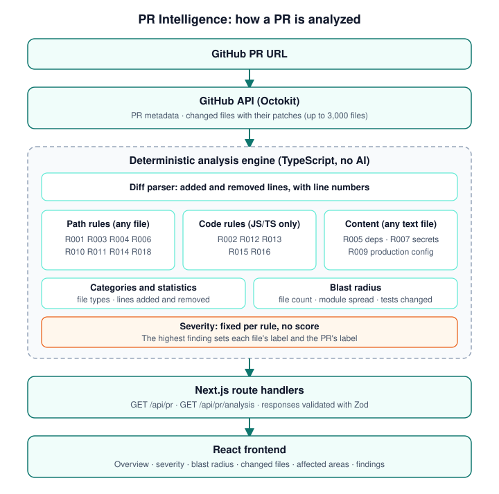

# PR Intelligence

## Screenshots

## The problem

Reviewing a pull request requires understanding of what changed, which parts of the codebase are affected, what tests are relevant, and whether there are potential risks. This is especially challenging if the codebase has long history and/or a lot of inner dependencies.

This tool automates the initial investigation. Paste a GitHub PR URL and it fetches the PR, analyzes the diff with deterministic rules (no AI), and shows what changed, which areas it touches, and which changes deserve a closer look, with a severity for each finding.

## Features

- **PR overview:** title, author, number and state (open, merged, closed), linked to GitHub, plus change statistics: files changed, lines added and removed, files added, modified and removed.
- **Overall severity:** the PR gets the highest severity among its findings (critical, high, medium, low or none), with a distribution of findings and files by severity.
- **Changed files table:** every changed file with its type, status and severity. Binary files and files without a diff are marked "Not scanned", never shown as clean.
- **Blast radius:** how widely the PR spreads, separate from severity: number of changed files, how many top-level modules they touch, and whether tests changed alongside JS/TS source. The file count and module spread are each rated contained, moderate or wide, and the PR gets the higher of the two. The tests signal says whether source changed without tests.
- **Affected Areas:** changed files grouped by area (Auth, Database, CI/CD, Configuration, Tests, Infrastructure, Security), with each file's severity within that area.
- **Findings by severity:** findings grouped into critical, high, medium and low, each showing the file and what was detected.

## Rules

Each rule has a fixed severity. A file's severity, and the PR's, is the highest severity among its findings. There is no numeric score.

| Rule | Flags | Severity | Applies to |
|------|-------|----------|------------|
| R001 | Authentication files modified | medium | Any file (path) |
| R002 | Authentication check potentially removed | high | JS/TS |
| R003 | Database migration added or modified | medium | Any file (path) |
| R004 | Database migration deleted | high | Any file (path) |
| R005 | Dependencies added, removed or upgraded | low | Dependency manifests |
| R006 | CI/CD workflow modified | medium | Any file (path) |
| R007 | Private key, API key or password pattern | critical | Any text file |
| R008 | More than 500 lines changed | medium | Not implemented |
| R009 | Production configuration modified | high | Any file |
| R010 | Test files removed | medium | Any file (path) |
| R011 | Infrastructure changes | medium | Any file (path) |
| R012 | Crypto algorithm changed | high | JS/TS |
| R013 | Password hashing changed | high | JS/TS |
| R014 | Security-sensitive path modified | high | Any file (path) |
| R015 | Unsafe navigation: `window.location` assigned from a dynamic value | high | JS/TS |
| R016 | Dangerous code execution or DOM sink introduced | high | JS/TS |
| R018 | Script changed with no content change: likely a permission change (e.g. `chmod +x`) | medium | Scripts (path) |

R017 was dropped before release and its ID is retired.

Rules and severities are defined in `lib/diff/util/risk-scoring.ts`.

## Language Scope

Source-code analysis covers **JavaScript and TypeScript only** (`.js`, `.jsx`, `.mjs`, `.cjs`, `.ts`, `.tsx`, `.mts`, `.cts`). Covering every programming language isn't realistic, so language-specific rules are written for JS/TS syntax and aren't expected to work for other languages. These include code-pattern detectors (removed auth checks, unsafe navigation, dangerous code execution, crypto and password hashing).

Files that aren't tied to one language are still analyzed:

- **Configuration and infrastructure:** `.env*`, `Dockerfile`, `docker-compose*`, Terraform, Kubernetes, Helm
- **CI/CD:** `.github/workflows/**`
- **Database:** migrations and schema files
- **Dependency manifests:** `package.json` (R005 also checks other ecosystems' manifests, but those checks aren't maintained)
- **Secrets:** keys, tokens and passwords added to any text file

Files in other languages still count toward file and line statistics and path-based checks, such as a sensitive `auth/` folder.

## Architecture

PR URL → GitHub client (Octokit) → diff parser and deterministic rules engine → Next.js route handlers → React frontend (responses validated with Zod)

Rules and severity are fully deterministic; no AI is involved in detection or severity.

## Tech Stack

| Component | Technology |
|-----------|------------|
| Frontend Framework | Next.js App Router |
| UI Library | React + TypeScript |
| Styling | Tailwind CSS |
| Backend Runtime | Node.js |
| API Layer | Next.js Route Handlers |
| Analysis Engine | TypeScript |
| GitHub Integration | Octokit |
| Severity Rules | Deterministic rule table (`lib/diff/util/risk-scoring.ts`) |
| Validation | Zod v4 schemas (`lib/schemas/`) for API responses and the `url` query param |
| Testing | Vitest |

## Core Principles

1. **Deterministic first:** all detection, parsing and severity assignment use explicit rules. Results are reproducible and don't depend on an AI's interpretation.
2. **Label-based categorization:** files are categorized by labels, with fallback categories (frontend, backend, tests, docs) when no label exists.
3. **Severity, not scores:** each rule has a fixed severity, and findings are shown as labelled severity groups. A numeric risk score was tried and removed as arbitrary.

## Known Limitations

The analysis works from the PR diff only, with no repository download, so some changes are missed or flagged wrongly. The main ones: source-code rules cover JavaScript and TypeScript only, only the first 3,000 files of a PR are analyzed (GitHub's limit), and path-based rules match by folder and file-name conventions.

Full list, rule by rule: [docs/KNOWN-LIMITATIONS.md](docs/KNOWN-LIMITATIONS.md).

## Design Decisions

Deterministic rules with fixed severities and no score, no AI in the core analysis, and no repository download. The reasons behind these and other choices: [docs/DESIGN-DECISIONS.md](docs/DESIGN-DECISIONS.md).
